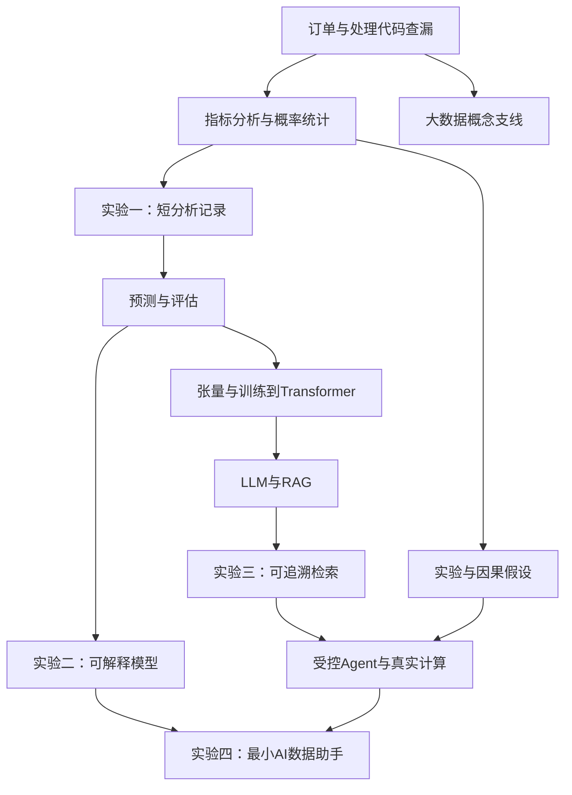

# 课程总览与内容覆盖表

科目：AI 数据科学：统计、机器学习与智能分析。设计日期：2026-11-11。

本表与同次交付的大纲共同构成完整课程设计。课程DAG只写当前schema支持字段；阶段、预计时间、深度、代码理解对象和选修条件以本表为准。所有节点初始未开始，生成大纲不代表已学会。

## 目标、深度与学习边界

核心掌握：能解释机制，读懂并修改关键代码，核验结果；基础理解：能说明用途、前提、输入输出和常见限制；精简复习：已有学习经历，以短代码和结果推演查漏，缺口就地补；后续选修：不阻塞主线，先满足相应进入条件。本表每个主题有主要深度，跨阶段再次出现表示应用与深化，不重复核心定义。

概率统计按基本遗忘从必要部分重建；不删除统计推断、效应量、区间、Bootstrap、检验与实验假设。线代、微积分只补当前任务所需：数组→向量矩阵→回归损失→导数梯度→链式法则。Hadoop/Spark及相关已学内容精简复习；Kafka、Flink/Flink SQL、Doris均从零教学。

普通课为概念课或实操课，总时长15～25分钟，包含回顾和至多一项5～10分钟小练习；没有理解障碍时可按实际缩短复习。概念课不产lab；实操课提供小骨架，不从空白写完整程序；实验课为项目里程碑，可分短时段完成，不另加长考试。表中实验时间包括使用骨架、检查证据及结果解释。

每次首次新写法讲清任务与输入、对象类型/形状、函数方法及参数、执行顺序、中间结果、输出、原理与本例错误；长链先拆成中间变量。SQL用中间表解释逻辑处理顺序，并说明该顺序不等同于数据库物理执行计划。未运行输出标为推演；固定响应只验流程，不能冒充真实模型效果。课件按进度生成，题目、数据、Notebook和lab由相应角色后续交付。

## 规模与时间

当前设计142节点、329条依赖边，其中概念133、实操5、实验4。普通课=概念+实操；“实践节点”=实操+实验，二者不能相加后再次计入总数。

| 范围 | 普通课（概念/实操） | 实验课 | 节点总数 | 教学时间 |
| --- | --- | --- | --- | --- |
| 主线必修A～G | 102（97/5） | 4 | 106 | 2135～2710分钟（35小时35分～45小时10分） |
| 必修概念支线H | 27（27/0） | 0 | 27 | 515～650分钟（8小时35分～10小时50分） |
| 全部必修A～H | 129（124/5） | 4 | 133 | 2650～3360分钟（44小时10分～56小时00分） |
| 后续选修X | 9（9/0） | 0 | 9 | 175～220分钟（2小时55分～3小时40分） |
| 全部已列单元（含选修） | 138（133/5） | 4 | 142 | 2825～3580分钟（47小时05分～59小时40分） |

必修普通课独计：2485～3130分钟（41小时25分～52小时10分）；必修实验课独计：165～230分钟（2小时45分～3小时50分）。五个普通实操课独计：100～125分钟（1小时40分～2小时05分）。上述总时长已包含各项练习，不另叠加。

选修时间只覆盖本表明确列出的九个有边界的学习单元，用于用途、前提、关键代码或结果推演；不声称这些时间足以精通高级因果、微调或平台工程。完整专项训练、复杂部署及未来新增项目尚未规划，不混入本轮时长。未指定每周投入，不据此推算日历完成日期。

| 阶段 | 重点与结果 | 概念 | 实操 | 实验 | 合计 | 时间 |
| --- | --- | --- | --- | --- | --- | --- |
| A 基础连接与查漏 | 解释小型处理流程，依据实际代码理解查缺口。 | 8 | 1 | 0 | 9 | 170～215分钟（2小时50分～3小时35分） |
| B 统计与分析 | 从问题、指标和抽样推断形成有逻辑的短分析。 | 22 | 0 | 1 | 23 | 475～605分钟（7小时55分～10小时05分） |
| C 实验与因果基础 | 判断实验结论和观察研究的识别假设。 | 12 | 0 | 0 | 12 | 230～290分钟（3小时50分～4小时50分） |
| D 机器学习 | 建立正确切分、可比较且可解释的预测流程。 | 20 | 1 | 1 | 22 | 450～570分钟（7小时30分～9小时30分） |
| E 深度学习到Transformer | 理解张量、训练迭代与Attention的输入输出。 | 14 | 1 | 0 | 15 | 285～360分钟（4小时45分～6小时00分） |
| F LLM与RAG | 形成可追溯检索和可核验LLM输出。 | 10 | 1 | 1 | 12 | 245～315分钟（4小时05分～5小时15分） |
| G Agent与智能分析 | 连接自然语言、真实计算、图表解释与失败评估。 | 11 | 1 | 1 | 13 | 280～355分钟（4小时40分～5小时55分） |
| H 大数据核心支线 | 复习已学机制，从零理解新组件并推演数据链路。 | 27 | 0 | 0 | 27 | 515～650分钟（8小时35分～10小时50分） |
| X 后续选修入口 | 明确后续方向的用途与进入门槛，不要求现在全部修读。 | 9 | 0 | 0 | 9 | 175～220分钟（2小时55分～3小时40分） |

## 知识依赖与安排理由

全部真实知识依赖由大纲的prerequisites与edges表达，两者逐边一致；列表顺序是一个合法拓扑顺序。主线各阶段按A→B→C→D→E→F→G学习；图中只连真正知识依赖，不用虚构边强迫所有主题成为后续模型的前置。阶段内以本表节点顺序为建议阅读顺序。

图为阶段摘要，不能替代逐节点DAG。支线入口h01需a05、b01，h02再需b03；可在B阶段清洗与指标就绪后穿插。h08开始Kafka，h14开始Flink，h22开始Doris；新组件不要求先复习完Spark。A～G没有任何节点依赖H，因此可以先集中完成数据科学主线，再补全部H必修理解。选修X均是末端分支，不阻塞主线或项目验收。

数学依赖：b09～b19只补统计任务需要的事件概率、条件概率、期望方差、分布、抽样和推断；b20→b21才正式建立向量与矩阵；d05→d06→d07由回归损失引出导数与梯度；e04补偏导和链式法则，再进入e05自动微分、e06一次更新。PCA在d19就地补投影与方差方向直觉，不要求先修完整特征值证明。

同一概念的主讲与复用：Embedding主讲e08，f07讲检索应用；Transformer主讲e15，f01讲语言任务；Tool Calling主讲g03，g05用于受控循环；Text-to-SQL与NL2SQL在g06/g07为同一主题；Git在a09建立、d21应用；描述归因b08与因果识别c06严格区分。

## 项目线索与里程碑

统一使用小型用户、订单、支付、行为事件及指标字典；预测标签和实验分组是同一课程数据的扩展，不假定学生有工作经验。首课用小表子集，a09提供完整数据字典与Notebook基础骨架。数据owner和题目owner后续按节点交付，不由本轮大纲伪造实际数据或运行证据。

| 项目与验收点 | 已学节点（即实验prerequisites） | 可观察产物与边界 | 最可能卡点 |
| --- | --- | --- | --- |
| 实验一：订单分析记录 | b03、b05、b06、b08、b16、b22 | 完成可复现的订单分析记录并说明限制；项目一产物：短分析记录、关键图表和口径说明 | 订单与支付连接造成行数放大；留存分母或时间窗口不一致；把相关性写成原因或遗漏样本限制 |
| 实验二：可解释预测模型 | d02、d04、d09、d10、d14、d16、d21 | 完成基线与改进模型并核验泄漏和误差；项目二产物：复购基线、XGBoost对照、错误样本与模型记录 | 预测后的字段泄漏到X；切分前在全量数据拟合预处理；比较规则不一致或只报准确率 |
| 实验三：可追溯检索 | f06、f07、f08、f09、f10、f11 | 完成带来源和拒答分支的最小检索回答；项目三中间产物：可查证的字典检索模块，不依赖大数据服务 | 分块丢失来源或时间口径；检索失败仍生成确定答案；把固定响应推演当真实模型评估 |
| 实验四：最小数据助手 | g02、g07、g08、g09、g10、g12、lab02、lab03 | 连通查询检索与解释并核验结果和失败案例；项目三最终产物：自然语言到真实计算、证据解释和评估的最小助手 | 工具返回值没有进入最终解释；SQL数值正确但指标口径错误；无限重试或没有不可回答测试 |

项目一从a01订单口径埋线，B阶段逐步补清洗、漏斗、留存与不确定性，lab01形成短分析；C阶段用同一数据附实验/因果解释，不再另造项目。项目二从a07的数组形状、b20/b21的特征矩阵埋线，D阶段完成复购基线与XGBoost改进，lab02验收。项目三从B/C的数据字典、可核验统计和E的表示机制埋线；F先取得检索证据模块，G再接真实查询、图表与评估，lab04完成最小助手。

手写与现成库对照集中在b20的逐项乘加与dot、d05的Xw+b与LinearRegression、d07的梯度更新与模型训练目标、e05的手算导数与autograd；f07可将小矩阵精确相似度与索引结果对照。对照只服务机制理解，不要求重复造完整库。

## 全节点明细

编号为本次大纲位次；节点id是稳定引用。深度为该课主目标，主题内部有不同深度时以后一节覆盖表为准。普通课含轻量自测，实操只补骨架关键处；所有H节点均为概念课。

### A 基础连接与查漏

| 位次与ID | 标题与目标 | 阶段/课型/深度 | 时间 | 前置节点（进入条件） | 要读懂的代码或推演对象 | 项目素材与用途 |
| --- | --- | --- | --- | --- | --- | --- |
| 0001 `a01` | 订单问题与代码查漏：辨明订单指标口径并解释短代码的数据变化 | A / 概念 / 精简复习 | 20～25分钟 | 已有Python/SQL基础；不假定新库熟练 | 列表与字典；DataFrame筛选、聚合及图表短片段；输入到输出 | 以项目一订单与用户小表开场，记录实际代码缺口 |
| 0002 `a02` | 表对象与索引对齐：解释筛选及索引对齐如何改变表的结果 | A / 概念 / 精简复习 | 15～20分钟 | a01 | Series与DataFrame；loc、布尔掩码、索引对齐后的行列 | 读取同一订单小表，防止项目一错位赋值 |
| 0003 `a03` | 缺失、重复与类型：依据字段含义选择缺失值和重复行处理 | A / 概念 / 精简复习 | 20～25分钟 | a02 | isna、drop_duplicates、astype；处理前后小表 | 为项目一形成清洗候选，不把缺失自动当零 |
| 0004 `a04` | 分组聚合与表粒度：解释分组键及聚合前后每行代表的对象 | A / 概念 / 核心掌握 | 20～25分钟 | a02 | groupby、agg、reset_index；SQL GROUP BY的中间表 | 计算项目一用户订单量和金额，核对分母 |
| 0005 `a05` | 连接、合并与拼接：预测连接和拼接对行数、列与索引的影响 | A / 概念 / 核心掌握 | 20～25分钟 | a03、a04 | merge的键和匹配；concat对象列表与axis；SQL JOIN | 合并项目一订单、用户、支付，识别一对多放大 |
| 0006 `a06` | 时间处理与窗口查询：解释时间筛选与窗口函数的分组和顺序 | A / 概念 / 核心掌握 | 20～25分钟 | a05 | to_datetime、时间差；SQL OVER、PARTITION BY、ORDER BY | 用订单时间生成用户首单与复购间隔 |
| 0007 `a07` | 数组形状与广播：依据数组形状推演切片、聚合与广播结果 | A / 概念 / 精简复习 | 20～25分钟 | a02 | ndarray的shape、dtype、axis；二维数组与向量广播 | 为项目二X/y和后续张量补查数组缺口 |
| 0008 `a08` | 图表对象与比较：选择图形并解释坐标、分组与误导风险 | A / 概念 / 精简复习 | 15～20分钟 | a04 | Figure、Axes；plot、hist、bar的输入与返回对象 | 用订单分布和分组转化小图服务项目一 |
| 0009 `a09` | 执行顺序与版本记录：复现骨架笔记本并说明版本记录的用途 | A / 实操 / 基础理解 | 20～25分钟 | a03、a06、a08 | Notebook单元与内核；git diff/commit；依赖与随机种子记录 | 提供统一数据字典与Jupyter骨架，修改并记录关键单元 |

### B 统计与分析

| 位次与ID | 标题与目标 | 阶段/课型/深度 | 时间 | 前置节点（进入条件） | 要读懂的代码或推演对象 | 项目素材与用途 |
| --- | --- | --- | --- | --- | --- | --- |
| 0010 `b01` | 问题、指标与分母：把订单问题写成有粒度和时间窗的指标 | B / 概念 / 核心掌握 | 20～25分钟 | a04、a06 | SQL COUNT、COUNT DISTINCT、条件聚合；指标输入表 | 为项目一确定支付转化、客单价和复购口径 |
| 0011 `b02` | 分布与描述统计：用分位数和离散程度描述偏态订单数据 | B / 概念 / 核心掌握 | 20～25分钟 | a07、a08 | describe、quantile、mean、median、std；样本与总体分母 | 比较订单金额，解释均值受大额订单影响 |
| 0012 `b03` | 清洗规则与质量检查：把异常记录转成可解释的数据质量规则 | B / 概念 / 核心掌握 | 20～25分钟 | a03、a05、b01 | 断言式条件、范围检查、连接后行数核验；规则结果表 | 保留项目一清洗日志，说明删除与保留依据 |
| 0013 `b04` | 相关与分组差异：区分相关、组间差异和因果结论 | B / 概念 / 核心掌握 | 20～25分钟 | b02、b03 | 散点图、corr；分层前后的组均值小表 | 检查优惠与金额关系，为因果阶段埋线 |
| 0014 `b05` | 漏斗与转化分析：计算有事件顺序及统一分母的转化漏斗 | B / 概念 / 核心掌握 | 20～25分钟 | b01、b03 | 事件筛选与去重；SQL条件聚合；步骤转化表 | 从访问到支付事件形成项目一漏斗 |
| 0015 `b06` | 留存与同群分析：解释同群留存矩阵的行列和时间窗口 | B / 概念 / 核心掌握 | 20～25分钟 | b05、a06 | 首日分组、日期差、pivot；Cohort留存矩阵 | 在项目一复用用户首次事件与回访事件 |
| 0016 `b07` | 用户分群与异常定位：按规则分群并区分异常信号和数据问题 | B / 概念 / 核心掌握 | 20～25分钟 | b02、b04、b06 | 分箱与条件标签；分群对比表；时间序列异常标记 | 在订单和用户行为中寻找值得核验的异常 |
| 0017 `b08` | 描述归因与分析边界：分解指标变化并陈述描述归因的限制 | B / 概念 / 核心掌握 | 20～25分钟 | b05、b06、b07 | 分组加权和、贡献拆解；变化前后对照小表 | 为项目一写贡献变化，不把贡献当因果效应 |
| 0018 `b09` | 概率与随机变量：把订单事件写成概率及随机变量 | B / 概念 / 核心掌握 | 20～25分钟 | b01、b02 | 事件布尔数组、频率计数；简单随机抽取的推演 | 用是否支付和订单金额连接统计任务 |
| 0019 `b10` | 条件概率与贝叶斯：用列联表计算条件概率并解释反向推断 | B / 概念 / 核心掌握 | 20～25分钟 | b09 | 二维频数表、条件分母；贝叶斯小数值计算 | 区分异常用户中高风险与高风险中异常 |
| 0020 `b11` | 期望与方差：计算随机收益的期望并解释方差 | B / 概念 / 核心掌握 | 20～25分钟 | b09、a07 | 概率与收益数组逐项乘法、求和；平方偏差求和 | 把项目一平均收益与波动连接到不确定性 |
| 0021 `b12` | 常用概率分布：按数据生成过程选择二项或正态近似 | B / 概念 / 基础理解 | 20～25分钟 | b10、b11 | scipy.stats的bernoulli、binom、norm；pmf与cdf | 解释支付次数和样本均值的建模边界 |
| 0022 `b13` | 抽样与选择偏差：说明样本如何影响分析结论的适用范围 | B / 概念 / 核心掌握 | 20～25分钟 | b09、b03 | 抽样索引与sample；总体、抽样框和样本小表 | 识别仅已支付用户造成的订单分析偏差 |
| 0023 `b14` | 大数律与中心极限定理：区分频率稳定与均值分布近似的条件 | B / 概念 / 基础理解 | 20～25分钟 | b11、b12、b13 | 重复抽样均值数组；样本量变化的分布推演 | 解释更多订单为何影响估计精度而非消除偏差 |
| 0024 `b15` | 估计与标准误：区分参数、统计量、标准差和标准误 | B / 概念 / 核心掌握 | 20～25分钟 | b14 | 均值、比例和标准误的小数值计算 | 解释项目一支付率估计为何具有不确定性 |
| 0025 `b16` | 置信区间的含义：计算简单区间并正确解释重复抽样含义 | B / 概念 / 核心掌握 | 20～25分钟 | b15 | scipy分布分位数与interval；返回上下界 | 为项目一关键指标补区间和样本限制 |
| 0026 `b17` | 自助法与重采样：解释Bootstrap重采样和区间的适用边界 | B / 概念 / 核心掌握 | 20～25分钟 | b13、b16、a07 | scipy.stats.bootstrap；统计函数、axis、成对重采样 | 比较订单均值和偏态金额的不确定性 |
| 0027 `b18` | 假设检验与概率值：解释检验假设、概率值和不能推出的结论 | B / 概念 / 核心掌握 | 20～25分钟 | b12、b16 | scipy.stats检验的输入、假设与statistic/pvalue | 为优惠比较和后续A/B实验建立推断语义 |
| 0028 `b19` | 效应量与实际意义：并列解释效应大小、区间和统计显著性 | B / 概念 / 核心掌握 | 20～25分钟 | b18、b16 | 均值差、比例差和相对变化；效应结果表 | 避免把很小但显著的支付变化直接当业务收益 |
| 0029 `b20` | 向量、点积与范数：用小数组解释点积、距离和向量形状 | B / 概念 / 基础理解 | 20～25分钟 | a07、b11 | 一维向量、dot、norm；相同输入的逐项和与库结果 | 为项目二线性预测、聚类及文本相似度搭前置 |
| 0030 `b21` | 矩阵乘法与线性映射：推演矩阵乘法的形状及逐行加权结果 | B / 概念 / 基础理解 | 20～25分钟 | b20 | 二维X与列向量w；X @ w；转置与广播区别 | 把订单特征矩阵连接到回归与Attention |
| 0031 `b22` | 短分析的证据组织：把计算、图表和限制组织成短分析记录 | B / 概念 / 核心掌握 | 15～20分钟 | b08、b17、b19、a09 | 骨架Notebook的清洗、指标、图表单元；结果引用 | 整合项目一，区分已算结果与待验证假说 |
| 0032 `lab01` | 实验一：订单分析记录：完成可复现的订单分析记录并说明限制 | B / 实验 / 核心掌握 | 40～60分钟 | b03、b05、b06、b08、b16、b22 | 提供数据与Jupyter骨架；补清洗、指标及结果解释关键处 | 项目一产物：短分析记录、关键图表和口径说明 |

### C 实验与因果基础

| 位次与ID | 标题与目标 | 阶段/课型/深度 | 时间 | 前置节点（进入条件） | 要读懂的代码或推演对象 | 项目素材与用途 |
| --- | --- | --- | --- | --- | --- | --- |
| 0033 `c01` | 随机化与实验单位：确定实验单位并解释随机分组的作用 | C / 概念 / 核心掌握 | 20～25分钟 | b13、b19 | 用户级分组表与订单级结果聚合；随机分配推演 | 给同一用户数据增加实验分组，不按订单重复计样本 |
| 0034 `c02` | 实验效应与不确定性：计算实验效应并联读区间和概率值 | C / 概念 / 核心掌握 | 20～25分钟 | c01、b18、b19 | 按实验单位聚合；效应差与区间；检验返回对象 | 复用订单支付率，在短分析中补实验附页 |
| 0035 `c03` | 样本量与检验功效：解释效应阈值、样本量和功效的取舍 | C / 概念 / 基础理解 | 20～25分钟 | c02、b15 | statsmodels Power的参数与返回样本量；输入量纲 | 判断小型订单实验不能排除多大效果 |
| 0036 `c04` | 实验质量与停止规则：识别分流、干扰和提前停止造成的问题 | C / 概念 / 核心掌握 | 20～25分钟 | c01、c02 | 分组比例核对、实验窗口过滤和单位去重小表 | 用实验分组与订单事件检查结论成立条件 |
| 0037 `c05` | 多重检验与选择偏差：解释多指标选择如何提高误报机会 | C / 概念 / 基础理解 | 20～25分钟 | c02、c04 | multipletests的输入p值列表与校正返回值 | 限制从大量订单指标中挑显著结果的解释 |
| 0038 `c06` | 潜在结果与混杂：区分相关差异与可识别的因果效应 | C / 概念 / 核心掌握 | 20～25分钟 | c01、b04、b08 | 处理、结果、协变量小表；反事实列的缺失推演 | 解释领券用户和未领券用户不可直接比较 |
| 0039 `c07` | 因果图与调整集合：用因果图判断混杂、中介和碰撞偏差 | C / 概念 / 基础理解 | 20～25分钟 | c06 | 变量依赖图与分层小表；不要求图算法库 | 画出优惠、活跃与支付的候选因果结构 |
| 0040 `c08` | 倾向评分匹配：解释匹配流程及不能消除的隐藏混杂 | C / 概念 / 基础理解 | 20～25分钟 | c06、c07 | 倾向分数列、共同支持与匹配前后平衡表 | 阅读提供的领券匹配结果，不把匹配当随机化 |
| 0041 `c09` | 双重差分与平行趋势：用双重差分计算政策效应并审查假设 | C / 概念 / 基础理解 | 20～25分钟 | c06、c07、a06 | 处理组与对照组的前后四格表；差上加差 | 推演优惠策略上线前后的支付变化 |
| 0042 `c10` | 工具变量的识别条件：说明工具变量用途及关键识别条件 | C / 概念 / 基础理解 | 15～20分钟 | c06、c07 | 工具、处理、结果的因果图；不引入估计API | 判断外部发券规则是否可能帮助识别优惠效应 |
| 0043 `c11` | 断点回归与局部效应：说明阈值规则何时支持局部因果比较 | C / 概念 / 基础理解 | 15～20分钟 | c06、c07 | 阈值两侧小表和散点；运行变量与处理状态 | 分析优惠资格阈值附近的比较条件 |
| 0044 `c12` | 因果主张的证据核对：按识别假设核对实验和观察研究结论 | C / 概念 / 核心掌握 | 20～25分钟 | c03、c04、c05、c08、c09、c10、c11 | 实验与观察分析的结果表；主张、假设和证据对应 | 将项目一中的建议改为有证据边界的结论 |

### D 机器学习

| 位次与ID | 标题与目标 | 阶段/课型/深度 | 时间 | 前置节点（进入条件） | 要读懂的代码或推演对象 | 项目素材与用途 |
| --- | --- | --- | --- | --- | --- | --- |
| 0045 `d01` | 预测任务与简单基线：定义预测时点、标签和可比较的基线 | D / 概念 / 核心掌握 | 20～25分钟 | b03、b21、lab01 | 用户特征X、标签y；Dummy模型与基线输出 | 项目二选未来复购预测，限定只用预测前信息 |
| 0046 `d02` | 数据切分与泄漏：依据预测任务切分数据并识别信息泄漏 | D / 概念 / 核心掌握 | 20～25分钟 | d01、a06 | 时间或分组索引；train/validation/test；切分前后形状 | 同一用户不跨错误切分，未来支付不进入特征 |
| 0047 `d03` | 预处理与特征工程：解释训练数据中学到的填补和编码规则 | D / 概念 / 核心掌握 | 20～25分钟 | d02、a05、a07 | SimpleImputer、StandardScaler、OneHotEncoder的fit/transform | 给项目二金额、活跃和类别特征规定处理流程 |
| 0048 `d04` | 流水线与交叉验证：把预处理纳入流水线并正确划分验证折 | D / 实操 / 核心掌握 | 20～25分钟 | d03 | ColumnTransformer、Pipeline；fit/transform/predict；CV折 | 提供项目二骨架，仅补预处理和模型连接处 |
| 0049 `d05` | 线性回归与残差：用线性回归解释系数、预测与残差 | D / 概念 / 核心掌握 | 20～25分钟 | b21、b04、d02 | 手算Xw+b与LinearRegression；coef_、predict、残差 | 用订单金额小例理解预测，不把系数解释为因果 |
| 0050 `d06` | 导数与损失变化：用差商说明导数怎样指示损失的变化 | D / 概念 / 基础理解 | 20～25分钟 | d05 | 单参数平方损失函数；有限差分与解析斜率 | 为项目二理解训练目标补最低微积分 |
| 0051 `d07` | 梯度下降与正则化：推演一次梯度更新并解释正则化作用 | D / 概念 / 核心掌握 | 20～25分钟 | d06、b21 | 参数向量、各方向斜率、learning_rate；更新前后损失 | 手写线性模型更新与库结果对照，不展开优化证明 |
| 0052 `d08` | 回归评估与误差：按任务选择回归指标并解释错误样本 | D / 概念 / 核心掌握 | 20～25分钟 | d05、d02 | MAE、MSE、R²；预测值和真实值的成对输入 | 比较金额预测的基线和线性模型作为方法对照 |
| 0053 `d09` | 逻辑回归与概率：连接线性分数、概率和分类训练目标 | D / 概念 / 核心掌握 | 20～25分钟 | d05、d07 | sigmoid手算与LogisticRegression；predict_proba列顺序 | 项目二以复购概率建立主要可解释基线 |
| 0054 `d10` | 分类阈值与评估指标：根据错误代价解释阈值和分类指标 | D / 概念 / 核心掌握 | 20～25分钟 | d09、d02、b19 | 混淆矩阵、precision/recall、ROC/PR；概率到标签 | 比较触达复购用户时漏报和误报的取舍 |
| 0055 `d11` | 不平衡与概率校准：识别不平衡误导并区分排序与概率可靠性 | D / 概念 / 基础理解 | 20～25分钟 | d10、b16 | 类别比例、class_weight；分箱概率与实际率对照 | 为项目二防止只报accuracy及过度相信预测概率 |
| 0056 `d12` | 决策树与复杂度：解释分裂、叶节点预测和树深的影响 | D / 概念 / 核心掌握 | 20～25分钟 | d03、d10 | DecisionTreeClassifier的fit/predict；路径与叶节点 | 把复购特征的小树路径解释为预测规则 |
| 0057 `d13` | 随机森林与集成：解释重采样和随机特征如何形成集成 | D / 概念 / 核心掌握 | 20～25分钟 | d12、b17 | RandomForestClassifier；树预测到集成概率 | 项目二比较单树与森林，不追加独立工程项目 |
| 0058 `d14` | 梯度提升与模型改进：解释提升的逐步修正并读懂主要训练参数 | D / 概念 / 核心掌握 | 20～25分钟 | d12、d07、d04 | XGBClassifier的n_estimators、learning_rate、eval_set；LightGBM关系 | 项目二选择XGBoost作为主要改进模型，另一库仅比较 |
| 0059 `d15` | 模型选择与过拟合：用学习曲线和验证结果判断模型复杂度 | D / 概念 / 核心掌握 | 20～25分钟 | d04、d08、d10、d14 | 训练与验证分数表；参数候选与独立测试输出 | 为项目二固定比较规则，避免反复试探测试集 |
| 0060 `d16` | 解释性与错误样本：核对重要特征及错误样本并说明解释限制 | D / 概念 / 核心掌握 | 20～25分钟 | d11、d13、d14、d15 | 系数、树重要性、置换重要性；错误样本切片 | 把项目二错误用户与数据字典对应，避免因果化重要性 |
| 0061 `d17` | 距离与均值聚类：解释标准化、距离和聚类中心的关系 | D / 概念 / 基础理解 | 20～25分钟 | b20、d03、b07 | KMeans的fit_predict、cluster_centers_；距离矩阵 | 把用户规则分群与无监督聚类并列比较 |
| 0062 `d18` | 密度聚类与噪声：解释密度邻域如何形成簇及噪声点 | D / 概念 / 基础理解 | 15～20分钟 | d17 | DBSCAN的eps、min_samples；labels_中的噪声标记 | 判断异常用户为何不必强行归入一个簇 |
| 0063 `d19` | 投影与主成分分析：解释投影、解释方差和降维后的形状 | D / 概念 / 基础理解 | 20～25分钟 | b21、d03 | 中心化矩阵、PCA的fit/transform、components_及解释方差 | 用用户特征降维小例，为表示学习搭直觉 |
| 0064 `d20` | 支持向量机的边界：解释间隔、核方法用途及尺度条件 | D / 概念 / 基础理解 | 15～20分钟 | d09、d17 | SVC的C、kernel；输入特征尺度与决策分数 | 只读小型分类边界，不为项目二再堆模型 |
| 0065 `d21` | 数据、模型与评估版本：记录数据切分、模型参数和评估结果的关联 | D / 概念 / 基础理解 | 15～20分钟 | d15、d16、a09 | 配置字典、版本标识、指标JSON；MLflow记录示意 | 为项目二保存可复核模型卡与实验记录 |
| 0066 `lab02` | 实验二：可解释预测模型：完成基线与改进模型并核验泄漏和误差 | D / 实验 / 核心掌握 | 45～60分钟 | d02、d04、d09、d10、d14、d16、d21 | Jupyter骨架的X/y、Pipeline、评估表和错误样本单元 | 项目二产物：复购基线、XGBoost对照、错误样本与模型记录 |

### E 深度学习到Transformer

| 位次与ID | 标题与目标 | 阶段/课型/深度 | 时间 | 前置节点（进入条件） | 要读懂的代码或推演对象 | 项目素材与用途 |
| --- | --- | --- | --- | --- | --- | --- |
| 0067 `e01` | 张量与维度操作：追踪张量的形状、类型及维度变化 | E / 概念 / 核心掌握 | 20～25分钟 | a07、b21、d07 | torch.tensor、reshape、unsqueeze、matmul；batch维 | 复用项目二特征小批次，进入训练代码而非大模型训练 |
| 0068 `e02` | 神经网络与前向计算：按层推演线性变换和非线性激活 | E / 概念 / 基础理解 | 20～25分钟 | e01、d09 | nn.Linear与激活；batch×features到batch×outputs | 用复购小模型比较线性预测和多层表示 |
| 0069 `e03` | 损失函数与小批量：对应输出形状选择损失并解释批量平均 | E / 概念 / 核心掌握 | 20～25分钟 | e02、d10 | logits、targets；交叉熵与MSE的输入形状和归约 | 解释复购模型输出与标签类型，避免维度误配 |
| 0070 `e04` | 偏导、梯度与链式法则：用复合小函数连接偏导、梯度和反向传播 | E / 概念 / 基础理解 | 20～25分钟 | d06、d07、e02 | 两参数复合函数；局部导数连乘与梯度向量 | 补齐训练循环所需数学，不推整套微积分 |
| 0071 `e05` | 自动微分与梯度累积：解释计算图、反向传播和梯度累积 | E / 概念 / 核心掌握 | 20～25分钟 | e03、e04 | requires_grad、loss.backward、parameter.grad；重复调用 | 用小张量核对手算导数和autograd返回结果 |
| 0072 `e06` | 一次训练迭代：解释清零、前向、反向和更新的执行顺序 | E / 实操 / 核心掌握 | 20～25分钟 | e05 | optimizer.zero_grad、forward、loss、backward、step；参数快照 | 在提供的短循环骨架补关键调用并解释损失变化 |
| 0073 `e07` | 训练、验证与优化器：区分训练验证状态并解释优化器的作用 | E / 概念 / 基础理解 | 20～25分钟 | e06、d15 | model.train/eval、no_grad、SGD/Adam；学习率与状态 | 把小神经网络与项目二基线在同一评估规则下对照 |
| 0074 `e08` | 嵌入与查表表示：解释索引查表如何得到可学习的向量 | E / 概念 / 核心掌握 | 20～25分钟 | e02、e06、b20 | nn.Embedding；整数索引batch×length到三维向量 | 将用户类别与文本词元连接到统一表示机制 |
| 0075 `e09` | 卷积网络的用途：解释卷积局部计算及图像任务的适用性 | E / 概念 / 基础理解 | 15～20分钟 | e02、e01 | 小卷积核滑动；Conv2d输入输出通道与形状 | 定位图像订单附件等扩展，不开展视觉专项 |
| 0076 `e10` | 循环网络与长短期记忆：解释序列状态和门控要处理的问题 | E / 概念 / 基础理解 | 15～20分钟 | e02、e01 | 按时间展开的隐藏状态；RNN/LSTM输入与输出维度 | 定位用户行为序列用途，为Attention比较建立边界 |
| 0077 `e11` | 查询、键与值：用点积和归一化推演注意力加权结果 | E / 概念 / 核心掌握 | 20～25分钟 | b20、b21、e08 | Q、K、V小矩阵；QK转置、缩放、softmax与权重乘V | 为项目三检索和LLM理解建立数据流直觉 |
| 0078 `e12` | 自注意力的输入输出：追踪自注意力矩阵形状并解释因果掩码 | E / 概念 / 核心掌握 | 20～25分钟 | e11 | 同一输入的Q/K/V投影；attention矩阵与mask | 连接文本序列和下一词预测，区分生成与双向读取 |
| 0079 `e13` | 多头注意力：解释拆头、并行注意力和拼接的形状 | E / 概念 / 基础理解 | 20～25分钟 | e12、e01 | batch×length×hidden拆成heads；transpose、concat与输出投影 | 以同一短文本追踪形状，不要求重写完整模块 |
| 0080 `e14` | 顺序与位置编码：解释注意力为何需要序列位置信息 | E / 概念 / 基础理解 | 15～20分钟 | e12 | 位置向量与词元表示相加；position_ids小例 | 解释订单文本顺序变化为何可能改变含义 |
| 0081 `e15` | Transformer的连接结构：串联注意力、前馈、残差与归一化 | E / 概念 / 基础理解 | 20～25分钟 | e13、e14、e07 | Transformer块输入输出；残差形状与模块调用顺序 | 为LLM阶段提供完整但有边界的架构理解 |

### F LLM与RAG

| 位次与ID | 标题与目标 | 阶段/课型/深度 | 时间 | 前置节点（进入条件） | 要读懂的代码或推演对象 | 项目素材与用途 |
| --- | --- | --- | --- | --- | --- | --- |
| 0082 `f01` | 语言建模与词元：连接词元、下一词预测和生成限制 | F / 概念 / 核心掌握 | 20～25分钟 | e08、e12、e15 | Tokenizer的encode/decode、input_ids、attention_mask；生成分数 | 项目三读取订单问句与数据字典短文本 |
| 0083 `f02` | 消息、请求与响应：解释模型调用的输入消息和响应结构 | F / 概念 / 核心掌握 | 20～25分钟 | f01、a09 | 角色消息列表、模型参数、请求和响应对象；异常分支 | 提供项目三模型接口骨架，可用明确标记的固定响应 |
| 0084 `f03` | 提示与上下文组织：组织任务、证据和约束并说明上下文取舍 | F / 概念 / 核心掌握 | 20～25分钟 | f02 | 提示模板、消息列表、证据字段与上下文预算 | 给数据助手提供指标字典与可用表，不编业务口径 |
| 0085 `f04` | 结构化输出与校验：解析结构化结果并区分格式和事实正确 | F / 概念 / 核心掌握 | 20～25分钟 | f03 | JSON Schema、解析对象、缺失字段、拒绝和不完整响应 | 让助手返回指标、时间范围和证据，保留错误分支 |
| 0086 `f05` | 检索与微调的选择：区分知识检索、行为适配和参数高效微调 | F / 概念 / 基础理解 | 15～20分钟 | f01、f03、e06 | 检索上下文与适配器配置示意；不运行微调 | 判断数据字典更新应先检索而非重新训练模型 |
| 0087 `f06` | 文档分块与元数据：解释分块边界及元数据如何影响证据 | F / 概念 / 核心掌握 | 20～25分钟 | f03、a06 | 文档到chunk记录列表；chunk_id、来源、时间和重叠 | 对项目三指标字典和分析记录分块，保留来源 |
| 0088 `f07` | 向量检索与索引：追踪查询向量到相似片段的检索过程 | F / 概念 / 核心掌握 | 20～25分钟 | f06、b20、e08 | 文本批次到embedding矩阵；相似度、top-k及向量库返回值 | 复用已有向量机制，为字典检索构建小索引骨架 |
| 0089 `f08` | 召回、过滤与重排：区分召回和重排并解释候选结果的变化 | F / 概念 / 核心掌握 | 20～25分钟 | f07 | 候选列表、元数据过滤、reranker分数与排序 | 对比同名但不同时间口径的字典片段 |
| 0090 `f09` | 证据拼接与引用：把检索片段连接到回答并核对引用 | F / 实操 / 核心掌握 | 20～25分钟 | f04、f08 | 检索结果列表到上下文、生成、引用解析的函数数据流 | 在项目三检索骨架补来源回传与缺证据分支 |
| 0091 `f10` | 检索增强的评估：用评估集分离检索错误和生成错误 | F / 概念 / 核心掌握 | 20～25分钟 | f09、b19 | 问题、标准证据、候选片段和答案的评估记录 | 为项目三建立可回答与不可回答的固定小评估集 |
| 0092 `f11` | 成本、延迟与可靠性：比较效果、成本和延迟并说明验证限制 | F / 概念 / 基础理解 | 15～20分钟 | f10、f02 | usage、计时、失败和缓存记录；评估汇总表 | 记录实际调用与固定响应推演，不能混称真实效果 |
| 0093 `lab03` | 实验三：可追溯检索：完成带来源和拒答分支的最小检索回答 | F / 实验 / 核心掌握 | 35～50分钟 | f06、f07、f08、f09、f10、f11 | Jupyter骨架中的分块、检索、引用与评估单元 | 项目三中间产物：可查证的字典检索模块，不依赖大数据服务 |

### G Agent与智能分析

| 位次与ID | 标题与目标 | 阶段/课型/深度 | 时间 | 前置节点（进入条件） | 要读懂的代码或推演对象 | 项目素材与用途 |
| --- | --- | --- | --- | --- | --- | --- |
| 0094 `g01` | 接口与最小服务：解释请求校验、函数调用和响应的数据流 | G / 概念 / 基础理解 | 20～25分钟 | f02、f04、d21 | HTTP请求/响应、FastAPI路由、类型与数据模型；预测接口 | 只读懂提供的最小服务代码，项目三可在Notebook直接调用 |
| 0095 `g02` | 环境、路径与依赖：解释路径、环境变量和容器的最低用途 | G / 概念 / 基础理解 | 15～20分钟 | a09、g01 | Linux路径与命令阅读、配置加载、依赖清单；镜像与容器示意 | 解释数据助手凭据和本地路径，不扩展为容器部署任务 |
| 0096 `g03` | 工具定义与调用协议：追踪工具参数、调用标识和结果回传 | G / 概念 / 核心掌握 | 20～25分钟 | f04、g01 | 工具JSON Schema、tool_call_id、参数解析、函数结果消息 | 把只读查询和检索包装成数据助手可调用工具 |
| 0097 `g04` | 固定工作流与状态：用显式状态串联查询、计算和解释步骤 | G / 概念 / 核心掌握 | 20～25分钟 | g03、lab03 | 普通Python函数、状态字典与分支；输入输出边界 | 先让项目三固定流程可追踪，再增加自主选择 |
| 0098 `g05` | 受控智能体与停止：解释计划、记忆和停止条件如何约束工具循环 | G / 概念 / 核心掌握 | 20～25分钟 | g04 | 受限工具循环、历史消息、步数与错误状态；短计划 | 给项目三限制工具和预算，保留人工核对结果入口 |
| 0099 `g06` | 自然语言到查询：将问句映射到表、指标、连接和时间条件 | G / 概念 / 核心掌握 | 20～25分钟 | g04、b01、a05、a06 | schema与字典到结构化查询意图、SQL；Text-to-SQL/NL2SQL同义 | 用同一订单数据回答支付、复购与留存问题 |
| 0100 `g07` | 查询核验与真实计算：核验SQL并把真实查询结果传回解释步骤 | G / 实操 / 核心掌握 | 20～25分钟 | g06、g03 | 只读SQL检查、执行函数、结果行与列；异常和超时分支 | 在项目三骨架补口径检查与真实结果返回，禁止凭空填数 |
| 0101 `g08` | 自动清洗与探索分析：核对自动清洗建议和EDA计算的实际证据 | G / 概念 / 核心掌握 | 20～25分钟 | g07、b03、b07、lab01 | 清洗建议JSON、待确认规则、EDA工具结果；数据差异 | 项目三只辅助形成规则和解释，清洗依据须可追踪 |
| 0102 `g09` | 图表、异常与业务解释：把计算结果转成可核对的图表和分析主张 | G / 概念 / 核心掌握 | 20～25分钟 | g08、a08、b08 | 图表规格、真实聚合结果、异常标记和结论字段 | Analytics Agent以真实计算支持项目一式短报告 |
| 0103 `g10` | 实验与因果分析助手：区分AI解释、统计计算和因果识别依据 | G / 概念 / 基础理解 | 20～25分钟 | g07、c12 | 实验计算工具的效应、区间与假设字段；解释输出 | 助手解释订单实验，缺随机化或假设证据时说明限制 |
| 0104 `g11` | 协议与框架的职责：解释MCP及两类框架在工具流程中的职责 | G / 概念 / 基础理解 | 20～25分钟 | g05、g01 | MCP客户端/服务器与工具schema；LangChain组件、LangGraph状态图 | 理解可替换的封装与互操作，主线沿用受控普通函数流程 |
| 0105 `g12` | 智能体评估与观测：按计算正确性、口径和失败轨迹评估助手 | G / 概念 / 核心掌握 | 20～25分钟 | g05、g09、g10、f11 | 问题集、工具轨迹、真实结果、引用、成本与错误标签 | 把项目三分成正常、缺数据、错口径和不可回答案例 |
| 0106 `lab04` | 实验四：最小数据助手：连通查询检索与解释并核验结果和失败案例 | G / 实验 / 核心掌握 | 45～60分钟 | g02、g07、g08、g09、g10、g12、lab02、lab03 | 提供模块化Jupyter骨架；SQL/检索、结果、图表、解释与评估 | 项目三最终产物：自然语言到真实计算、证据解释和评估的最小助手 |

### H 大数据核心支线

| 位次与ID | 标题与目标 | 阶段/课型/深度 | 时间 | 前置节点（进入条件） | 要读懂的代码或推演对象 | 项目素材与用途 |
| --- | --- | --- | --- | --- | --- | --- |
| 0107 `h01` | 事实、维度与分析系统：解释表粒度、数仓分层和事务分析的区别 | H / 概念 / 精简复习 | 15～20分钟 | a05、b01 | 事实/维度小表；MySQL类事务查询与分析查询示意SQL | 解释同一订单数据怎样服务分析和AI，不部署MySQL |
| 0108 `h02` | 数据转换与增量处理：推演增量转换和质量规则怎样影响分析 | H / 概念 / 精简复习 | 15～20分钟 | h01、b03 | ETL/ELT步骤、增量键与更新时间；批次前后小表 | 为项目一理解迟到、重复和口径变化，仅读代码 |
| 0109 `h03` | 分布式存储与批处理：串联HDFS、副本、MapReduce与资源管理职责 | H / 概念 / 精简复习 | 20～25分钟 | h02 | 文件块和副本图；map/shuffle/reduce伪代码与YARN任务流程 | 用订单汇总链路查漏，不安装或运行Hadoop |
| 0110 `h04` | 表、分区与批量查询：解释Hive与Hadoop及SQL表查询的关系 | H / 概念 / 精简复习 | 15～20分钟 | h03、a06 | Hive建表、日期分区和筛选SQL；分区小表 | 说明订单分区为何影响读取范围，不建服务 |
| 0111 `h05` | 对象与分布式执行职责：区分Spark执行角色及两类数据对象 | H / 概念 / 精简复习 | 20～25分钟 | h03、a07 | PySpark RDD与DataFrame短片段；Driver/Executor职责 | 对照订单Python聚合与Spark表达，只读与推演 |
| 0112 `h06` | 惰性执行与数据交换：追踪转换、行动、DAG和Shuffle的触发关系 | H / 概念 / 精简复习 | 20～25分钟 | h05 | filter、select、groupBy、count；Transformation/Action短链拆解 | 预测订单聚合何时执行、何时交换数据 |
| 0113 `h07` | 分区、缓存与适用条件：解释分区和缓存何时减少重复计算 | H / 概念 / 精简复习 | 15～20分钟 | h06 | repartition、partitionBy、cache与重复action的计划推演 | 只讨论订单分析的重复读取，不做调优实验 |
| 0114 `h08` | 事件流与消息系统：说明事件流用途并区分生产、存储和消费职责 | H / 概念 / 基础理解 | 20～25分钟 | h02 | 订单事件JSON；Producer、Broker、Topic、Consumer的数据流伪代码 | 从零解释Kafka与数据库、文件的差别 |
| 0115 `h09` | 分区顺序与消费位置：追踪消息键、分区顺序和Offset的关系 | H / 概念 / 核心掌握 | 20～25分钟 | h08 | key/value订单事件进入分区；分区内offset小表 | 推演同一订单事件的顺序边界，不做真实发送 |
| 0116 `h10` | 消费者组与再均衡：推演分区分配、并行消费和成员变化 | H / 概念 / 基础理解 | 20～25分钟 | h09 | Consumer Group到Partition分配表；Rebalance前后位置 | 追踪消费成员增减怎样影响订单读取 |
| 0117 `h11` | 保留、重放与副本：解释消息持久化、保留重放和副本的用途 | H / 概念 / 基础理解 | 20～25分钟 | h09 | 保留日志、重置读取位置与副本确认流程图 | 解释下游重算为何需要订单事件历史 |
| 0118 `h12` | 确认、提交与投递语义：推演故障位置怎样导致重复或丢失 | H / 概念 / 核心掌握 | 20～25分钟 | h10、h11 | 发送确认、处理结果、offset提交的时间线 | 把订单重复计数连接到业务指标，避免无条件保证 |
| 0119 `h13` | 生产消费代码追踪：读懂发送、订阅、读取及提交的短伪代码 | H / 概念 / 基础理解 | 20～25分钟 | h12 | 明确标为伪代码的send/subscribe/poll/commit；key与位置 | 逐条追踪订单事件，不运行客户端或连接Kafka |
| 0120 `h14` | 流计算与算子链：追踪持续事件经过源、变换与输出的过程 | H / 概念 / 基础理解 | 20～25分钟 | h08、h02 | Source→Transformation→Sink伪代码；算子与并行实例 | 从零进入Flink，不把Java API当先修 |
| 0121 `h15` | 事件时间与水位线：用乱序事件解释时间语义和水位线作用 | H / 概念 / 核心掌握 | 20～25分钟 | h14、a06 | 事件时间、到达时间、Watermark三列表；时间线推演 | 用迟到订单区分数据时间与系统处理时刻 |
| 0122 `h16` | 窗口与分组聚合：推演滚动、滑动和会话窗口的归属与结果 | H / 概念 / 核心掌握 | 20～25分钟 | h15、a04 | 带时间戳的订单事件到窗口归属表及聚合值 | 比较实时支付指标的窗口口径，不运行Flink |
| 0123 `h17` | 状态、快照与恢复：区分状态、Checkpoint和Savepoint的用途 | H / 概念 / 基础理解 | 20～25分钟 | h14、h12 | 状态表、输入位置、快照与故障恢复时间线 | 说明订单累计量怎样恢复以及恢复条件 |
| 0124 `h18` | 端到端一致性的条件：说明精确一次所需的输入、状态和输出条件 | H / 概念 / 核心掌握 | 20～25分钟 | h17、h12 | 可重放输入、状态快照、事务或幂等输出的故障推演 | 判断重复订单何时仍会进入分析结果 |
| 0125 `h19` | 动态表与更新记录：用插入和撤回记录解释动态表的结果变化 | H / 概念 / 核心掌握 | 20～25分钟 | h16、h17、a05 | 动态表快照；INSERT/UPDATE/DELETE与Changelog小表 | 解释流聚合结果为何可持续更新，不类比成静态SQL |
| 0126 `h20` | 流表定义与时间属性：解释流表字段、连接器声明和时间属性 | H / 概念 / 核心掌握 | 20～25分钟 | h15、h19 | Flink SQL CREATE TABLE；TIMESTAMP、WATERMARK与WITH声明 | 分段阅读订单流DDL，只推演不连接真实源 |
| 0127 `h21` | 窗口查询与结果输出：区分窗口计算、关闭条件和输出更新 | H / 概念 / 核心掌握 | 20～25分钟 | h20、h16、h19 | Flink SQL窗口聚合；输入事件、Watermark与结果变化 | 追踪少量支付事件到窗口结果及下游Changelog |
| 0128 `h22` | 列式分析与并行查询：解释Doris列式存储、并行查询及节点职责 | H / 概念 / 基础理解 | 20～25分钟 | h01 | 按行与按列读取小表；MPP及FE/BE请求流 | 从零理解分析数据库，联系订单多维聚合用途 |
| 0129 `h23` | 三类表模型的语义：比较重复、唯一和聚合模型的结果差异 | H / 概念 / 核心掌握 | 20～25分钟 | h22、h19 | 同批重复订单在Duplicate/Unique/Aggregate表中的小表 | 区分追加、更新去重与聚合，不让表模型改写指标 |
| 0130 `h24` | 分区与分桶：区分数据裁剪和分布组织的用途 | H / 概念 / 基础理解 | 15～20分钟 | h22、h04、h07 | 日期分区与哈希分桶的订单分配表；建表片段 | 解释同一日期筛选与同键分布，不堆生产配置 |
| 0131 `h25` | 导入、更新与物化视图：解释数据进入分析表及预计算的结果语义 | H / 概念 / 基础理解 | 20～25分钟 | h23、h24 | 批量导入与更新记录；物化聚合前后小表 | 推演迟到订单更新后聚合如何变化 |
| 0132 `h26` | 建表查询与结果推演：依据表模型和数据组织预测查询结果 | H / 概念 / 核心掌握 | 20～25分钟 | h25 | Doris简短CREATE TABLE和SELECT；关键字段与模型声明 | 阅读订单分析SQL，不执行建表或服务连接 |
| 0133 `h27` | 事件链路与分析口径：追踪Kafka到Flink及Doris的结果与故障影响 | H / 概念 / 核心掌握 | 20～25分钟 | h13、h18、h21、h26、b01 | 订单JSON→窗口Changelog→Doris记录→指标表；重复延迟推演 | 解释数据如何供分析与AI使用，项目三仍不依赖这些服务 |

### X 后续选修入口

| 位次与ID | 标题与目标 | 阶段/课型/深度 | 时间 | 前置节点（进入条件） | 要读懂的代码或推演对象 | 项目素材与用途 |
| --- | --- | --- | --- | --- | --- | --- |
| 0134 `x01` | 工具变量的局部解释：核对工具变量估计对象及其适用人群 | X / 概念 / 后续选修 | 20～25分钟 | c10、c12、d05 | 工具分配、依从类型和两阶段估计的小表推演 | 用于存在可信外生工具的政策分析，非普通相关数据默认方法 |
| 0135 `x02` | 断点分析的稳健性：解释带宽和阈值附近选择对断点估计的影响 | X / 概念 / 后续选修 | 20～25分钟 | c11、c12、d05 | 阈值两侧窗口、拟合线与带宽变化对照 | 用于明确阈值分配规则，不能外推全体用户效应 |
| 0136 `x03` | 增益建模的进入条件：区分响应预测与处理效应异质性任务 | X / 概念 / 后续选修 | 15～20分钟 | c01、c12、d10、lab02 | 处理组/对照组、特征与结果的输入表；无未核实算法API | 用于差异化干预；进入前需随机实验或可信识别、重叠及基本监督学习，按EconML官方入口定位 |
| 0137 `x04` | 监督微调的数据准备：说明监督微调样本、切分和评估的约束 | X / 概念 / 后续选修 | 20～25分钟 | f05、f10、e07 | SFT消息样本、训练验证分割、格式和泄漏检查 | 用于稳定行为适配；需合法任务数据和固定评估集后再考虑训练 |
| 0138 `x05` | 低秩适配与参数高效训练：解释低秩适配器及可训练参数的边界 | X / 概念 / 后续选修 | 20～25分钟 | x04、e04、b21 | LoRA的低秩矩阵形状；PEFT配置与适配器加载短片段 | 用于算力有限的行为适配；需训练原理与匹配版本，当前不跑大模型训练 |
| 0139 `x06` | 多智能体的协作代价：比较任务分工的收益及通信和核验成本 | X / 概念 / 后续选修 | 20～25分钟 | g05、g12、lab04 | 两个角色的消息与共享状态轨迹；失败和成本记录 | 仅在单Agent稳定且可测、确有分工需求后进入 |
| 0140 `x07` | 框架状态与持久化：解释状态图、恢复点和框架封装的数据流 | X / 概念 / 后续选修 | 20～25分钟 | g11、g12、lab04 | LangGraph状态与节点、checkpoint；LangChain模型工具封装对照 | 用于长流程恢复和工具集成；先有可核验普通函数实现 |
| 0141 `x08` | 容器与服务配置阅读：读懂最小容器和服务配置的依赖关系 | X / 概念 / 后续选修 | 20～25分钟 | g01、g02、lab04 | Dockerfile、端口、环境变量与依赖配置；只读示例 | 用于后续共享服务；先理解本地复现，复杂部署另立后续项目 |
| 0142 `x09` | 发布前的评估门槛：说明数据模型版本、回归评估和回退条件 | X / 概念 / 后续选修 | 20～25分钟 | d21、g12、lab04 | 版本清单、评估报告、发布条件和日志记录 | 用于后续持续交付；需稳定数据和评估集，平台实现另行规划 |

## 11模块逐主题覆盖表

以下逐项对应用户能力地图，补充了教学中特别要求的依赖。每行给出明确节点、阶段、深度、用途和进入条件；主题合用节点表示一套核心讲授与后续应用。H主题的“核心掌握”指能解释机制和推演代码/事件，绝不要求运行组件。

### 模块1：编程与数据基础

| 主题 | 阶段与具体节点 | 学习深度 | 定位与用途 | 进入条件与边界 |
| --- | --- | --- | --- | --- |
| Python | A、G：a01、a02、g04 | 精简复习 | 理解容器、函数参数、对象方法及短流程；缺口就地补 | 已有基础；按a01实际查漏进入 |
| SQL | A、G：a04、a05、a06、g06、g07 | 核心掌握 | 核对逻辑处理顺序、聚合、多表和窗口；执行真实分析 | 先理解表粒度和连接键a04、a05 |
| NumPy | A、B：a07、b20、b21 | 精简复习 | 理解数组索引、切片、shape、axis、向量化及广播 | a02之后，数学意义在b20、b21补齐 |
| Pandas | A、B：a02、a03、a04、a05、a06、b03 | 核心掌握 | 完成筛选、清洗、分组、merge/concat和时间处理 | a01查漏，已有写法不重复从导入讲 |
| Matplotlib | A、G：a08、g09 | 精简复习 | 解释图表对象、坐标与输入数据，服务结果表达 | a04聚合结果；自动图表前完成a08 |
| Jupyter | A、B、D、F、G：a09、lab01、lab02、lab03、lab04 | 基础理解 | 使用骨架并按顺序复现计算与解释 | 先完成小表读取与关键变换a03、a06、a08 |
| Git | A、D：a09、d21 | 基础理解 | 保存差异、版本与实验上下文 | 能阅读Notebook和文件；不要求复杂协作 |

### 模块2：数学与统计

| 主题 | 阶段与具体节点 | 学习深度 | 定位与用途 | 进入条件与边界 |
| --- | --- | --- | --- | --- |
| 概率论与随机变量 | B：b09、b10、b11 | 核心掌握 | 只补支付事件、随机量和不确定性所需概率 | 从零重建；已有指标与描述统计b01、b02 |
| 数理统计 | B：b13、b14、b15、b16、b17、b18、b19 | 核心掌握 | 连接样本、估计、区间和检验，不展开无关证明 | b09、b11、b12后按依赖推进 |
| 描述统计 | B：b02 | 核心掌握 | 用均值、分位数和离散程度描述订单分布 | a07数组和a08图表 |
| 概率分布 | B：b12 | 基础理解 | 识别伯努利、二项和正态的生成过程与条件 | b10条件概率与b11期望方差 |
| 抽样 | B：b13 | 核心掌握 | 判断样本来源、代表性和选择偏差 | b09概率；b03质量规则 |
| 参数估计 | B：b15 | 核心掌握 | 区分总体参数、统计量、标准差与标准误 | b14抽样均值机制 |
| 置信区间 | B、C：b16、c02 | 核心掌握 | 表述估计不确定性，避免把置信水平当参数概率 | b15标准误和重复抽样 |
| 假设检验 | B、C：b18、c02 | 核心掌握 | 解释原假设、p值、错误类型与不能推出的结论 | b12分布及b16区间 |
| 相关分析 | B：b04 | 核心掌握 | 用散点与相关指标描述关联并限制解释 | b02分布和b03清洗 |
| 回归分析 | D：d05、d08、d09 | 核心掌握 | 解释系数、残差、假设与预测；不把系数当因果 | b21矩阵；b04相关；d02切分 |
| 线性代数 | B、D：b20、b21、d19 | 基础理解 | 按需掌握向量、点积、范数、矩阵乘法和投影 | a07数组；投影前补中心化与方差方向 |
| 微积分与优化基础 | D、E：d06、d07、e04 | 基础理解 | 用变化率、偏导、梯度和链式法则理解训练 | d05损失情境；复合函数在e04展开 |
| 条件概率与贝叶斯 | B：b10 | 核心掌握 | 从列联表区分条件方向并作反向推断 | b09事件与概率 |
| 大数定律与中心极限定理 | B：b14 | 基础理解 | 解释精度变化及近似分布，保留独立性等条件 | b11方差、b12分布、b13抽样 |
| 效应量 | B、C：b19、c02 | 核心掌握 | 同时判断效应大小、区间和实际价值 | b16区间与b18检验 |
| Bootstrap | B：b17 | 核心掌握 | 用重采样理解和估计不确定性，识别依赖数据限制 | b13抽样、b16区间、a07数组 |

### 模块3：数据分析

| 主题 | 阶段与具体节点 | 学习深度 | 定位与用途 | 进入条件与边界 |
| --- | --- | --- | --- | --- |
| 数据清洗 | A、B、G：a03、b03、g08 | 核心掌握 | 按字段语义清洗，保留规则、差异及证据 | a03基础操作后在b03制定质量规则 |
| EDA | B、G：b02、b04、b07、b22、g08 | 核心掌握 | 从分布、分组与异常形成可核对的分析线索 | a08图表及b03数据质量 |
| 指标体系 | B：b01、b08 | 核心掌握 | 定义目标、指标、分母及拆解关系 | a04粒度和a06时间 |
| 漏斗 | B：b05 | 核心掌握 | 解释有顺序的事件转化和分母变化 | b01指标及b03清洗 |
| 留存 | B：b06 | 核心掌握 | 定义回访、同群与观察期，识别未成熟窗口 | b05事件漏斗和a06时间 |
| Cohort Analysis（同群分析） | B：b06 | 核心掌握 | 读取同群矩阵及其分母；与留存同课讲授 | b05和a06；不重复另开同义课 |
| 用户分群 | B、D：b07、d17 | 核心掌握 | 先规则分群作业务比较，再理解聚类差别 | b02、b04、b06；算法层只要求基础理解 |
| 异常分析 | B、G：b07、g09 | 核心掌握 | 比较基准并核对异常信号与数据错误 | 质量规则b03和分组比较b04 |
| 归因分析 | B、C：b08、c06、c12 | 核心掌握 | 描述变化贡献；因果解释另查识别依据 | b05、b06、b07；c06补因果边界 |
| 数据可视化 | A、B、G：a08、b22、g09 | 核心掌握 | 选择并解释图形，用可追溯数据支持建议 | a04聚合与a08图表对象 |

### 模块4：实验与因果推断

| 主题 | 阶段与具体节点 | 学习深度 | 定位与用途 | 进入条件与边界 |
| --- | --- | --- | --- | --- |
| A/B Test | C：c01、c02、c04 | 核心掌握 | 用正确实验单位估计效应并核对执行质量 | b13抽样、b18检验、b19效应量 |
| 实验设计 | C：c01、c03、c04、c05 | 核心掌握 | 预定指标、单位、窗口与停止规则 | 先理解随机化c01与效应c02 |
| RCT（随机对照实验） | C：c01、c06 | 核心掌握 | 说明随机化如何支持交换性及结论边界 | b13与b19；c06统一潜在结果语言 |
| 样本量与Power | C：c03 | 基础理解 | 判断设计能检测的效应和未显著的局限 | c02效应及b15标准误 |
| 多重检验 | C：c05 | 基础理解 | 理解大量比较的误报与校正含义 | c02检验、c04规则 |
| 因果推断基础 | C：c06、c12 | 核心掌握 | 区分相关、反事实、识别与估计 | c01随机化及b04、b08 |
| DAG（因果图） | C：c07 | 基础理解 | 识别混杂、中介、碰撞和可调整路径 | c06潜在结果与混杂；不同于Spark计算DAG |
| PSM（倾向评分匹配） | C：c08 | 基础理解 | 理解分数、重叠和平衡，不能消除隐藏混杂 | c06、c07；阅读给定分数，不要求提前学分类器 |
| DID（双重差分） | C：c09 | 基础理解 | 手算前后四格效应并检查平行趋势等假设 | c06、c07及a06时间 |
| IV（工具变量） | C、X：c10、x01 | 基础理解→后续选修 | 先学用途及识别条件，选修再看局部效应 | c06、c07；深入前完成c12与d05并有可信工具 |
| Regression Discontinuity（断点回归） | C、X：c11、x02 | 基础理解→后续选修 | 理解阈值局部比较，选修再审带宽和稳健性 | c06、c07；需明确阈值规则及无精确操纵的依据 |
| Uplift Modeling（增益建模） | C、X：c12、x03 | 后续选修 | c12只定位异质效应；x03区分响应预测与增量效应 | 随机实验或可信识别与重叠；c01、c12、d10、lab02及EconML官方入口 |

### 模块5：机器学习

| 主题 | 阶段与具体节点 | 学习深度 | 定位与用途 | 进入条件与边界 |
| --- | --- | --- | --- | --- |
| Scikit-learn | D：d01、d03、d04 | 核心掌握 | 理解X/y及fit、transform、predict的数据流 | a07数组和d02正确切分 |
| 特征工程 | D：d01、d02、d03 | 核心掌握 | 限定预测可得信息并处理数值和类别特征 | 表质量b03及预测时点d01 |
| 训练、验证与测试集 | D：d02、d15 | 核心掌握 | 按时间和用户分组切分，隔离测试集 | d01明确目标和预测时点 |
| 交叉验证 | D：d04、d15 | 核心掌握 | 保证折内拟合，匹配时间或分组依赖 | d02、d03；不默认随机K折适合全部任务 |
| 模型评估 | D：d08、d10、d11、d15、d16 | 核心掌握 | 按任务与错误代价评估并解释错误样本 | d02切分及相应模型输出 |
| Linear Regression（线性回归） | D：d05、d08 | 核心掌握 | 连接加权预测、最小二乘、残差和指标 | b21矩阵、b04关联与d02 |
| Logistic Regression（逻辑回归） | D：d09、d10 | 核心掌握 | 连接分数、概率、损失和阈值 | d05线性映射、d07优化 |
| Decision Tree（决策树） | D：d12 | 核心掌握 | 解释分裂、预测路径与复杂度 | d03特征及d10分类指标 |
| Random Forest（随机森林） | D：d13 | 核心掌握 | 解释重采样、随机特征与集成 | d12树与b17重采样 |
| XGBoost | D：d14、lab02 | 核心掌握 | 项目二主要改进模型；解释提升和验证参数 | d12、d07、d04；后续课件核对安装版本 |
| LightGBM | D：d14 | 基础理解 | 说明与XGBoost同属梯度提升树及实现差别 | 先完成树和提升直觉；不增加双库实践 |
| SVM（支持向量机） | D：d20 | 基础理解 | 理解间隔、软间隔、核方法和尺度条件 | d09分类与d17距离 |
| K-Means | D：d17 | 基础理解 | 读懂距离、聚类中心和簇数选择 | b20向量、d03缩放及b07规则分群 |
| DBSCAN | D：d18 | 基础理解 | 理解密度邻域、噪声与参数敏感性 | d17距离与尺度 |
| PCA | D：d19 | 基础理解 | 用投影和解释方差理解线性降维与信息损失 | b21矩阵、d03中心化；就地补方向与方差直觉 |
| 聚类与降维 | D：d17、d18、d19 | 基础理解 | 区分找群组和压缩表示，避免把簇当天然标签 | 向量距离、标准化及矩阵形状 |
| Pipeline | D：d04、lab02 | 核心掌握 | 将预处理和模型放入一致且可验证的流程 | d03理解fit从训练数据学习的信息 |
| 基线 | D：d01、lab02 | 核心掌握 | 用简单可复现基准判断模型是否改善 | 明确任务、预测时点和评估口径 |
| 过拟合与欠拟合 | D：d12、d15 | 核心掌握 | 联读训练和验证表现并调整复杂度 | d04验证与d08、d10指标 |
| 数据泄漏 | D：d02、d03、d04、d15 | 核心掌握 | 识别未来信息、跨组重复和全量预处理泄漏 | d01任务时间及表连接a05 |
| 误差分析 | D：d08、d16、lab02 | 核心掌握 | 切片错误并与特征和数据质量对照 | 正确评估与模型输出，不只看单个总分 |

### 模块6：深度学习

| 主题 | 阶段与具体节点 | 学习深度 | 定位与用途 | 进入条件与边界 |
| --- | --- | --- | --- | --- |
| PyTorch | E：e01、e03、e05、e06、e07 | 核心掌握 | 读懂小模型张量和一次训练循环 | a07、b21、d07；不要求训练大模型 |
| 神经网络 | E：e02、e03 | 基础理解 | 解释线性层、激活和输出形状 | e01张量及d09分数概率 |
| 前向传播 | E：e02 | 核心掌握 | 逐层追踪输入、参数和输出 | e01张量与b21线性映射 |
| 反向传播 | E：e04、e05 | 基础理解 | 把链式法则、计算图与梯度连接起来 | d06导数、d07梯度及e02前向 |
| 损失函数 | D、E：d05、d09、e03 | 核心掌握 | 按输出和标签形状选择并解释损失 | 先在回归中讲平方损失，再在训练中应用 |
| 梯度下降 | D、E：d07、e06 | 核心掌握 | 手算更新与库调用相对照，解释学习率 | d06变化率与b21参数向量 |
| 优化器 | E：e06、e07 | 基础理解 | 理解zero_grad、step及SGD/Adam的职责 | e05自动微分；不展开全部优化算法 |
| Embedding | E、F：e08、f07 | 核心掌握 | 解释可学习查表表示；检索阶段复用向量概念 | e02、e06与b20；语义检索再看f07 |
| CNN | E：e09 | 基础理解 | 定位图像任务与局部共享计算 | e01、e02；完整视觉专项在本计划外 |
| RNN/LSTM | E：e10 | 基础理解 | 解释序列状态与门控用途 | e01、e02；不训练完整序列专项模型 |
| Transformer | E、F：e15、f01 | 基础理解 | 理解模块连接及其在语言模型中的使用 | e13多头、e14位置与e07训练验证 |
| Attention | E：e11 | 核心掌握 | 推演Q/K/V、权重及加权输出 | b20、b21及e08向量表示 |
| Self-Attention | E：e12 | 核心掌握 | 追踪同源投影、上下文表示与因果掩码 | e11注意力基本运算 |
| Multi-Head Attention | E：e13 | 基础理解 | 追踪拆头、并行、拼接与输出投影形状 | e12及e01维度操作 |
| Positional Encoding | E：e14 | 基础理解 | 解释顺序信息及位置与内容的结合 | e12；不要求推完整位置编码公式 |

### 模块7：LLM

| 主题 | 阶段与具体节点 | 学习深度 | 定位与用途 | 进入条件与边界 |
| --- | --- | --- | --- | --- |
| LLM基础原理 | F：f01 | 核心掌握 | 把Transformer、下一词预测与生成限制连接起来 | e08、e12、e15；不训练基础大模型 |
| Token/Tokenizer | F：f01 | 核心掌握 | 解释文本到整数序列及掩码和长度 | 理解Embedding输入和模型序列形状 |
| Embedding | E、F：e08、f07 | 核心掌握 | 主讲表示机制一次，检索阶段应用不重复定义 | 查表训练e08；相似检索f07 |
| Transformer | E、F：e15、f01 | 基础理解 | 从已学模块连接到生成任务 | 先完成e11至e15的依赖链 |
| Prompt Engineering | F：f03 | 核心掌握 | 组织任务、证据与输出约束 | f02输入消息与响应 |
| Structured Output | F：f04 | 核心掌握 | 解析schema、拒绝与不完整响应并核验内容 | f03上下文与g01前的基本API调用f02 |
| Function Calling/Tool Calling | G：g03、g05 | 核心掌握 | 追踪工具定义、参数、ID、返回及循环 | f04结构化输出和g01函数接口 |
| Context Engineering | F：f03、f09 | 核心掌握 | 选择上下文证据与预算并保留来源 | f02调用、f03基本组织；检索应用在f09 |
| RAG机制 | F：f06、f07、f08、f09、lab03 | 核心掌握 | 串联文档、检索、证据生成与引用 | f03、f04及向量前置；不要求部署向量服务 |
| Chunking | F：f06 | 核心掌握 | 推演边界、重叠和元数据对证据的影响 | f03上下文及a06时间元数据 |
| Vector Database | F：f07 | 基础理解 | 解释索引、相似查询、元数据与返回记录 | b20向量及e08表示；主线可用本地小索引 |
| Retrieval | F：f07、f08 | 核心掌握 | 区分查询、候选集、过滤和相关证据 | f06文档记录与f07向量形状 |
| Reranking | F：f08 | 核心掌握 | 解释候选召回与重排阶段、分数及排序变化 | f07相似检索；不绑定复杂多模型实现 |
| RAG Evaluation | F：f10、lab03 | 核心掌握 | 拆分检索和生成错误，核验引用及不可回答 | f09完整证据链；有固定评估问题和标准证据 |
| Fine-tuning | F、X：f05、x04、x05 | 基础理解→后续选修 | 先比较行为适配和检索，再考虑有边界的微调入口 | f05定位；深挖需e07训练与f10评估 |
| SFT | F、X：f05、x04 | 基础理解→后续选修 | 理解监督样本和行为适配，选修审数据切分 | 有稳定任务数据、评估集和训练基础 |
| LoRA | F、X：f05、x05 | 基础理解→后续选修 | 理解低秩适配用途，选修追踪参数形状 | x04及e04、b21；版本匹配后再实施 |
| PEFT | F、X：f05、x05 | 基础理解→后续选修 | 定位参数高效方法与适配器配置 | 先区分基础模型与适配器，不照搬main开发文档 |
| LLM Evaluation | F、G：f10、f11、g12 | 核心掌握 | 定义评估集、指标、错误分类和结果核验 | 任务与证据链明确，区分实际调用和推演 |
| 成本/延迟取舍 | F、G：f11、g12 | 基础理解 | 在同一评估规则下比较费用、速度与可靠性 | f10效果评估及f02实际请求记录 |

### 模块8：AI Agent

| 主题 | 阶段与具体节点 | 学习深度 | 定位与用途 | 进入条件与边界 |
| --- | --- | --- | --- | --- |
| Agent基础架构 | G：g03、g04、g05 | 核心掌握 | 先固定流程再受控单Agent，解释模型和工具分工 | f04结构化输出、g01接口及lab03检索模块 |
| Tool Calling | G：g03 | 核心掌握 | 读懂schema、工具参数、结果回传和失败分支 | 与模块七同一节点，不重复核心讲授 |
| Planning | G：g05 | 基础理解 | 使用可检查的短计划，认识模型计划可能失败 | g04显式流程已可追踪 |
| Memory | G：g05 | 基础理解 | 区分历史消息、当前状态和持久化信息 | g04状态传递；不得把对话历史当事实数据库 |
| Workflow | G：g04 | 核心掌握 | 用普通函数和状态字典串联受控步骤 | g03工具协议及lab03检索 |
| Multi-Agent | X：x06 | 后续选修 | 比较分工收益、通信成本和核验负担 | g05、g12、lab04；单Agent已稳定且确有分工需求 |
| MCP | G：g11 | 基础理解 | 解释客户端/服务器及工具互操作边界 | g05受控调用和g01接口 |
| LangChain | G、X：g11、x07 | 基础理解→后续选修 | 定位模型、检索及工具封装；选修再比较组件数据流 | 先有普通函数实现；深入前完成g12、lab04 |
| LangGraph | G、X：g11、x07 | 基础理解→后续选修 | 定位图、状态及恢复；选修阅读持久化数据流 | g05停止机制和g12评估；按安装版本核对API |
| Agent Evaluation | G：g12、lab04 | 核心掌握 | 评价计算、口径、证据、失败轨迹及成本 | g05、g09、g10及f11；固定正常和失败样例 |

### 模块9：AI + 数据科学

| 主题 | 阶段与具体节点 | 学习深度 | 定位与用途 | 进入条件与边界 |
| --- | --- | --- | --- | --- |
| Text-to-SQL/NL2SQL | G：g06、g07 | 核心掌握 | 把问句转为有口径的查询并核验真实结果 | a05、a06、b01及g04；两个名称同一主题 |
| Data Agent | G：g05、g07、lab04 | 核心掌握 | 以受限工具查询和核验真实数据 | 具备SQL口径、工具数据流和失败评估 |
| Analytics Agent | G：g08、g09、lab04 | 核心掌握 | 串起计算、图表和有依据的短分析 | 先有项目一分析能力与g07真实结果 |
| 自动EDA | G：g08 | 核心掌握 | 解释工具返回分布与分组证据，避免语言猜测 | b02、b07、lab01及g07 |
| 自动清洗 | G：g08 | 核心掌握 | 形成可核验的规则建议、变更差异和日志 | b03清洗依据及真实数据，不自动接受全部修改 |
| 自动生成SQL | G：g06、g07 | 核心掌握 | 与自然语言问数同一流程，检查连接和过滤 | 已有SQL逻辑顺序、表字典与指标定义 |
| 自动图表 | G：g09 | 核心掌握 | 检查图表规格与真实数据、坐标和分组一致 | a08和g08，不以图形生成成功代替解释 |
| 自动异常检测 | G：g09 | 基础理解 | 在基准和计算证据上标记异常并提示核验 | b07异常分析和g08；不展开异常算法专项 |
| 自动业务洞察 | G：g09 | 核心掌握 | 把结果与假设区分并明确结论限制 | b08描述归因及真实计算g07 |
| RAG + 企业数据 | F、G：f06、f09、g04、lab04 | 核心掌握 | 用仿企业指标字典和分析记录保留证据来源 | lab03检索模块及g04流程；使用课程数据不假定工作经历 |
| LLM + 因果推断/实验分析 | G：g10 | 基础理解 | 让LLM解释真实统计量和假设，不生成因果依据 | c12实验因果证据核对及g07计算回传 |

### 模块10：数据工程

| 主题 | 阶段与具体节点 | 学习深度 | 定位与用途 | 进入条件与边界 |
| --- | --- | --- | --- | --- |
| MySQL | H、G：h01、g01 | 基础理解 | 定位关系数据库、事务与分析查询边界 | 已有SQL基础；未核MySQL方言不写API课，不部署 |
| 数据仓库 | H：h01、h02 | 精简复习 | 复习事实/维度、粒度、分层与质量责任 | a05连接、b01指标与b03清洗 |
| ETL/ELT | H：h02 | 精简复习 | 用增量输入解释转换发生位置和质量影响 | h01分析表语义及b03规则 |
| Hadoop | H：h03 | 精简复习 | 串联HDFS块与副本、MapReduce及YARN | h02批次与数据链路；学校学过只查漏 |
| Hive | H：h04 | 精简复习 | 复习与Hadoop/SQL关系、表、分区及基本处理 | h03与a06；不安排Hive安装 |
| Spark | H：h05、h06、h07 | 精简复习 | 复习执行职责、对象、惰性DAG、Shuffle、分区与缓存 | h03及a07；短PySpark/SQL阅读和推演 |
| Kafka | H：h08、h09、h10、h11、h12、h13 | 基础理解（关键机制核心掌握） | 从零学事件、分区、进度、组、副本和语义 | h02数据流；不把接触名称当掌握 |
| Flink | H：h14、h15、h16、h17、h18、h19 | 基础理解（时间与一致性核心掌握） | 从零学算子、事件时间、窗口、状态和恢复条件 | h08事件流与h02；不要求先学Java API |
| Flink SQL | H：h19、h20、h21 | 核心掌握 | 追踪动态表、Changelog、时间DDL与窗口输出 | h15、h16、h17的时间、窗口和状态 |
| Doris | H：h22、h23、h24、h25、h26 | 基础理解（表模型与结果核心掌握） | 从零学列式MPP、FE/BE、三模型、组织、导入与SQL | h01分析系统；表模型需h19更新语义 |
| 大规模数据处理 | H：h03、h05、h06、h07、h27 | 基础理解 | 理解分布式与批流职责，解释结果和口径风险 | 相应组件前置；无集群、性能调优或运行实验 |
| Kafka→Flink→Doris链路 | H：h27 | 核心掌握 | 追踪格式变化、重复、延迟及其分析影响 | h13、h18、h21、h26；全程事件和结果推演 |

### 模块11：工程化

| 主题 | 阶段与具体节点 | 学习深度 | 定位与用途 | 进入条件与边界 |
| --- | --- | --- | --- | --- |
| Linux | G：g02 | 基础理解 | 读懂路径、命令、环境变量和依赖位置 | a09复现与g01接口；不讲系统管理专项 |
| Git | A、D：a09、d21 | 基础理解 | 记录代码差异及实验版本 | 与模块一同一核心节点，不重复建课 |
| Docker | G、X：g02、x08 | 基础理解→后续选修 | 理解镜像/容器及隔离；选修只读最小配置 | 主线先本地可复现；深入需g01、g02、lab04 |
| API | F、G：f02、g01、g03 | 核心掌握 | 读懂请求响应、校验、工具参数及结果 | 先理解f02数据对象；FastAPI部分只基础理解 |
| FastAPI | G、X：g01、x08 | 基础理解 | 阅读最小路由、类型与请求响应 | f02、f04、d21；不开展平台开发 |
| 数据库 | H、G：h01、g01、g07 | 基础理解 | 区分表存储、接口连接和真实只读计算 | 已有SQL与表粒度；方言和连接配置单独核对 |
| 向量数据库 | F：f07 | 基础理解 | 说明向量索引、元数据和检索返回值 | b20、e08、f06；不要求服务安装 |
| Model Serving | G、D：g01、d21 | 基础理解 | 连接保存的模型、输入校验、predict和响应 | lab02之前的模型流程及f02、f04 |
| ML Pipeline | D：d04、d21、lab02 | 核心掌握 | 组织切分、预处理、训练、评估和版本 | d02、d03；与scikit-learn Pipeline同一主线 |
| MLOps基础 | D、X：d21、x09 | 基础理解→后续选修 | 记录数据模型评估版本；选修定义发布和回退条件 | 先有正确可复现的预测流程，平台建设不在当前单元 |
| LLMOps基础 | F、G、X：f11、g12、x09 | 基础理解→后续选修 | 记录提示、评估集、轨迹、成本和失败 | f10评估、g12观测；复杂运维另立项目 |
| 代码组织、配置与日志 | A、D、G：a09、d21、g02、g12 | 基础理解 | 保留可复现文件、配置、日志与版本关联 | 项目骨架已有明确模块输入输出；不建立重平台 |
| 复杂部署、容器运维与平台建设 | X：x08、x09 | 后续选修 | 当前选修仅作配置阅读和门槛设计，完整实现待新目标 | 主线完成且出现实际共享服务需求，再定技术和资源 |

## 大数据细项与教学边界

Hadoop与Spark相关精简复习节点：h01事实/维度及事务分析、h02 ETL/ELT增量与批流、h03 HDFS副本/MapReduce/YARN、h04 Hive表与分区、h05 Driver/Executor及RDD/DataFrame/Spark SQL、h06 Transformation/Action与惰性DAG/Shuffle、h07分区/缓存与适用条件。

Kafka从零：h08用途与角色；h09 Key、Partition、分区内顺序、Offset；h10 Consumer Group、并行分配与Rebalance；h11持久化、保留/重放、副本；h12确认、提交、重复/丢失和投递语义；h13生产消费短伪代码。

Flink/Flink SQL从零：h14有界/无界、Source/Transformation/Sink、算子/并行度；h15事件/处理时间、乱序/Watermark；h16滚动/滑动/会话窗口与聚合；h17状态/Checkpoint/恢复/Savepoint；h18Exactly-once的源、状态、Sink条件；h19 Table/SQL、动态表与Changelog；h20字段、连接器声明、时间属性与水位DDL；h21窗口SQL、关闭与迟到及输出更新。

Doris从零：h22列式/MPP、FE/BE（OLTP/OLAP在h01先定位）；h23 Duplicate/Unique/Aggregate模型；h24分区/分桶；h25导入/更新/聚合与物化视图；h26简短建表/查询结果。h27串起事件产生→Kafka保留→Flink处理→Doris分析→分析/AI使用结果，检查重复、延迟、更新与口径。

以上全部只用机制、短Python/SQL/伪代码、小表或时间线推演，不安装、部署、连真实服务、运行组件或做调优实验。推演和预期输出须明确标记。AI助手使用本地课程数据与骨架，大数据组件不构成运行依赖。

## 来源依据、核对与非阻塞缺口

已先读资料角色冻结的资源清单再正式设计；稳定统计与因果主干参考OpenIntro、ISLP、What If及Mixtape作者教材，必要数学与Transformer优先中文《动手学深度学习》，API与组件按官方资料核对。优先用中文讲解；官方英文资料作为核对依据，不把未转换书籍或目录声称为已取得全文。

资源清单由资料角色负责维护真实节点映射；本轮提供resource-node-map供总控转交。框架stable/latest/main入口未固定实际安装版本，正文和骨架生成时须按安装版本核对API，不能把本轮资料连通性当程序运行证明。MySQL官方站当前不可取，不写未核方言API，主线小型SQL用已核DuckDB官方资料。

最终已与正式44条资源逐项核对，所有大纲URL均来自已核清单；补充了LangChain分块、Qdrant召回/重排、LangSmith RAG评估、Kafka 4.4入门与设计、EconML/PyWhy异质效应六个具体入口。Uplift仅在c12定位异质效应、x03说明用途和进入条件；深入实现仍需选定方法、数据、识别假设和效应验证。缺少合适权威开放中文整体教材的统计/因果部分采用作者官方英文入口、中文教学，不据此删减核心内容。

领域校验提示中的d18、d19、d20、e09、e10是有意保留的非阻塞理解分支，h27与选修X是终点；不为消除正常末端提示制造虚假前置。无学习进度、真实作答或掌握结论由本轮生成。

## 首课安排

a01《订单问题与代码查漏》，概念课，20～25分钟，目标：辨明订单指标口径并解释短代码的数据变化。直接从“订单金额增加是否意味着更多用户完成支付”进入小表与短代码；只安排一项关联代码查漏，不连续导学，不另开长摸底。查漏结果决定a02/a03/a07/a08实际展开深度；并不预先把任何节点记为掌握。
